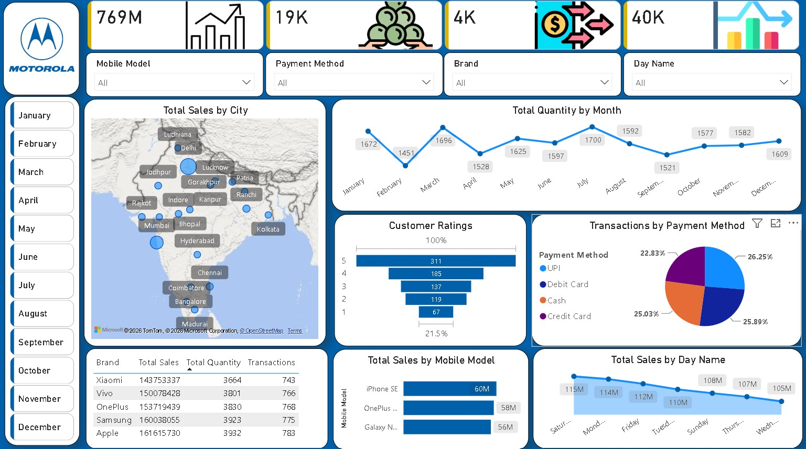

# 📱 Mobile Sales Data Analysis

## 📊 Project Overview

This project is an interactive **Mobile Sales Data Analysis Dashboard** developed using **Microsoft Excel** and **Power BI**.

The project focuses on analyzing mobile phone sales data to understand sales performance, customer behavior, payment preferences, product performance, and overall business trends.

The cleaned and prepared data was used in Power BI to create an interactive dashboard with key performance indicators and visualizations.

---

## 🎯 Project Objectives

* Analyze overall mobile sales performance
* Track total sales and transactions
* Analyze sales trends over time
* Identify top-performing mobile brands and models
* Analyze sales by city
* Understand customer payment preferences
* Analyze customer ratings
* Compare sales performance across different dimensions
* Create an interactive dashboard for business reporting

---

## 🛠️ Tools & Technologies

* **Microsoft Excel** – Data preparation and initial analysis
* **Microsoft Power BI** – Data visualization and interactive dashboard
* **Power Query** – Data transformation
* **DAX** – Calculated measures and KPIs

---

## 📁 Dataset

The project uses the **Mobile Sales Data** dataset containing information related to mobile phone sales.

The dataset includes fields related to:

* Mobile Brand
* Mobile Model
* Sales Amount
* Quantity Sold
* Transaction Date
* Customer Information
* Payment Method
* City
* Customer Rating

---

## 🔄 Project Workflow

### 1. Data Preparation – Excel

The mobile sales dataset was prepared and reviewed using Microsoft Excel.

The data preparation process included:

* Reviewing the dataset
* Checking data consistency
* Organizing the data
* Ensuring proper formatting
* Preparing the dataset for Power BI analysis

### 2. Dashboard Development – Power BI

The prepared dataset was imported into Power BI to create an interactive sales dashboard.

Power BI was used for:

* Data transformation
* Creating calculated measures
* KPI development
* Data visualization
* Interactive filtering
* Business performance analysis

---

## 📌 Key Performance Indicators

The dashboard provides an overview of important mobile sales metrics, including:

* **Total Sales**
* **Total Quantity Sold**
* **Total Transactions**
* **Average Sales**

These KPIs provide a quick overview of the overall sales performance.

---

## 📈 Dashboard Analysis

The dashboard provides insights into different aspects of mobile sales:

### 📅 Sales Trend Analysis

Monthly and time-based sales analysis helps identify sales patterns and changes in performance over time.

### 📱 Brand & Model Analysis

Sales performance can be analyzed across different mobile brands and models to identify high-performing products.

### 🌍 City-wise Sales Analysis

The dashboard provides a geographical view of sales performance across different cities.

### 💳 Payment Method Analysis

Different payment methods are analyzed to understand customer payment preferences.

### ⭐ Customer Rating Analysis

Customer ratings are analyzed to understand customer satisfaction and its distribution across sales.

### 📊 Interactive Filters

The dashboard allows users to filter and explore the data interactively based on available dimensions such as:

* Month
* Mobile Brand
* Mobile Model
* Payment Method
* City

---

## 💡 Key Business Insights

The dashboard helps businesses:

* Monitor overall mobile sales performance
* Identify high-performing mobile brands and models
* Understand sales trends over time
* Identify cities with higher sales contribution
* Understand customer payment preferences
* Analyze customer ratings
* Support data-driven sales and business decisions

---

## 📷 Dashboard Preview



---

## 📂 Project Structure

```text
Mobile-Sales-Data-Analysis/
│
├── README.md
├── Mobile_Sales.jpg
│
├── Data/
│   └── Mobile Sales Data.xlsx
│
└── PowerBI/
    └── Mobile Sales Dashboard.pbix
```

---

## 🚀 How to Use

### Excel Dataset

The dataset is available in the `Data` folder:

```text
Mobile Sales Data.xlsx
```

### Power BI Dashboard

Open the Power BI file from the `PowerBI` folder:

```text
Mobile Sales Dashboard.pbix
```

Use **Microsoft Power BI Desktop** to open and interact with the dashboard.

---

## 📚 Skills Demonstrated

* Microsoft Excel
* Power BI
* Power Query
* DAX
* Data Preparation
* Data Analysis
* Data Visualization
* Dashboard Development
* KPI Development
* Business Intelligence

---

## 👤 Author

**Raj Dubey**

Aspiring Data Analyst

**Skills:** Excel | SQL | Python | Power BI | Data Analysis
